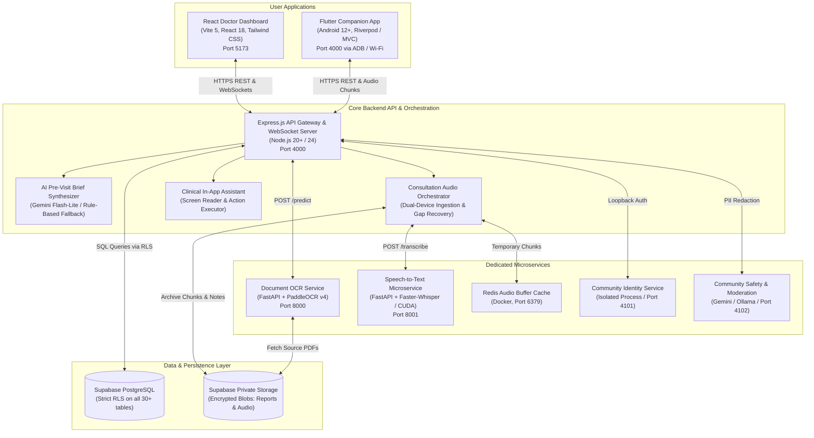
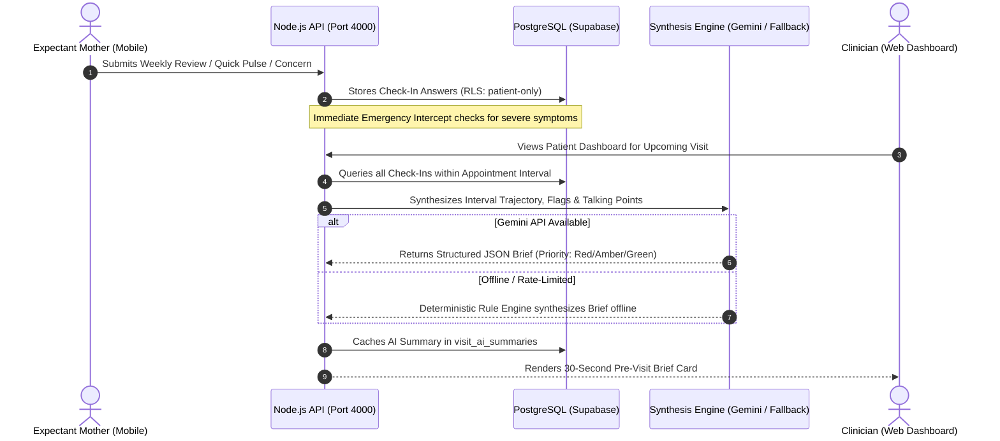
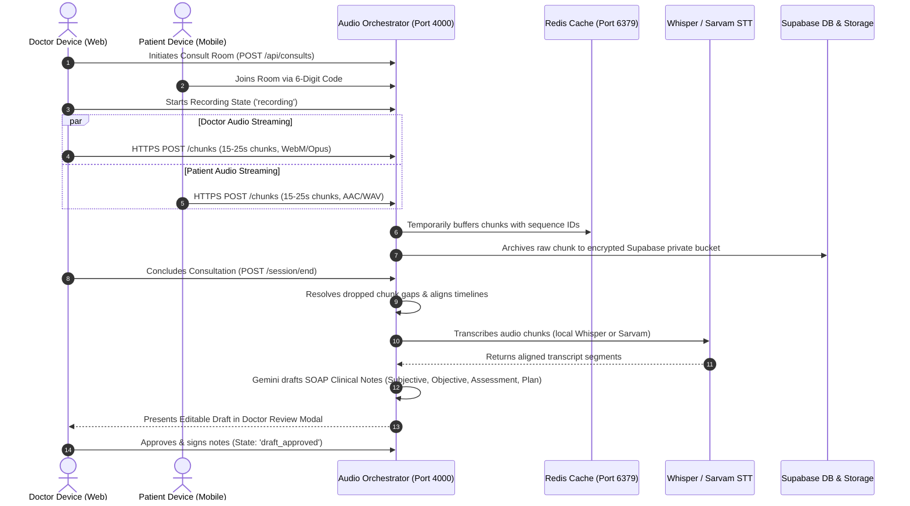

# Health-On (MedBrief) — System Architecture & Technical Specification

This document provides a comprehensive architectural breakdown of the **Health-On (MedBrief)** platform, detailing system topology, component interactions, database schemas, security layers, and asynchronous event pipelines.

---

## 1. High-Level System Architecture

Health-On employs a hybrid microservices-and-modular-monolith architecture designed for high availability, low-latency offline resilience, and strict clinical privacy.



---

## 2. Core Service Topology

### 2.1 Backend API Server (`server/`)
- **Runtime**: Node.js v24 (leveraging native `--env-file` parameter and modern ES features).
- **HTTP Framework**: Express.js with Zod schema validation across all route boundaries.
- **Real-Time Communication**: Socket.IO server used strictly for server-to-client push events (e.g. consultation state changes, audio upload acknowledgments).
- **Resilience**: Zero socket dependency for business state mutations; all mutations occur via idempotent HTTPS REST transactions.

### 2.2 React Web Dashboard (`client/`)
- **Stack**: React 18, Vite 5, Tailwind CSS, Lucide React, and React Router DOM.
- **Target Audience**: OB/GYN clinicians, nurses, and maternal health clinic staff.
- **Capabilities**: Real-time consultation audio review modal, 30-second AI clinical brief cards, interactive vitals flowsheets, lab report triage queues, and appointment magic-link invites.

### 2.3 Mobile Companion App (`mobile/`)
- **Stack**: Flutter 3.22+ (Android-first).
- **Target Audience**: Expectant mothers across all trimesters.
- **Capabilities**: Guided 4-step weekly milestone wizards, 30-second quick pulse check-ins, ambient consultation audio recording with pause detection, digitized lab report uploads, and anonymous peer support.

### 2.4 Document OCR Microservice (`PaddleOCRFastAPI/`)
- **Stack**: Python 3.12, FastAPI, PaddleOCR v4, `pdfplumber`, `PyMuPDF`.
- **Function**: Ingests uploaded physical lab photos and PDFs, strips visual noise, parses tabular data, and extracts quantitative biochemical metrics.

### 2.5 Local Speech-to-Text Microservice (`whisper-service/`)
- **Stack**: Python 3.12, FastAPI, `faster-whisper`, CUDA hardware acceleration.
- **Function**: Transcribes streamed consultation audio chunks locally on port `8001` with zero data leaving the clinic boundary.

---

## 3. Data Flow Pipelines

### 3.1 AI-Powered Prenatal Check-In & Pre-Visit Brief Pipeline



---

### 3.2 Ambient Dual-Device Consultation Audio Pipeline



---

## 4. Database Schema & Security Models

### 4.1 Key Table Entities

```text
┌─────────────────────────────────┐       ┌─────────────────────────────────┐
│            profiles             │       │          appointments           │
├─────────────────────────────────┤       ├─────────────────────────────────┤
│ id (UUID, PK)                   │◄──────┤ patient_id (UUID, FK)           │
│ role (clinician | patient)      │       │ clinician_id (UUID, FK)         │
│ email, full_name, phone         │       │ scheduled_at, status            │
│ is_verified (clinicians)        │       │ room_code, invite_token         │
└─────────────────────────────────┘       └────────────────┬────────────────┘
                 │                                         │
                 │ 1:N                                     │ 1:N
                 ▼                                         ▼
┌─────────────────────────────────┐       ┌─────────────────────────────────┐
│    patient_checkin_sessions     │       │        consult_sessions         │
├─────────────────────────────────┤       ├─────────────────────────────────┤
│ id (UUID, PK)                   │       │ id (UUID, PK)                   │
│ patient_id (UUID, FK)           │       │ appointment_id (UUID, FK)       │
│ cadence_tier (weekly/pulse/etc) │       │ state (recording/draft_ready)   │
│ comfort_rating (1 to 5)         │       │ doctor_device_id                │
│ answers (JSONB)                 │       │ patient_device_id               │
└─────────────────────────────────┘       └────────────────┬────────────────┘
                                                           │
                                                           │ 1:N
                                                           ▼
                                          ┌─────────────────────────────────┐
                                          │          audio_chunks           │
                                          ├─────────────────────────────────┤
                                          │ id (UUID, PK)                   │
                                          │ session_id (UUID, FK)           │
                                          │ device_type (doctor | patient)  │
                                          │ sequence_number (INT)           │
                                          │ storage_path, duration_ms       │
                                          │ checksum_sha256                 │
                                          └─────────────────────────────────┘
```

---

## 5. Security, Cryptography & Clinical Safeguards

### 5.1 Row-Level Security (RLS)
Every PostgreSQL table enforces strict RLS policies:
- Patients can only query and mutate their own records (`auth.uid() = patient_id`).
- Clinicians can only access records of patients explicitly linked to their appointments or care team.
- Anonymous identity mappings in community peer support are completely inaccessible to clinical roles.

### 5.2 Storage Envelope Encryption
All audio files and digitized medical reports stored in Supabase private storage are protected with **Envelope Encryption**:
- **Data Encryption Key (DEK)**: Randomly generated AES-256-GCM symmetric key per file.
- **Key Encryption Key (KEK)**: Server-side RSA-4096 keypair (`STORAGE_ENCRYPTION_RSA_PUBLIC_KEY` and `STORAGE_ENCRYPTION_RSA_PRIVATE_KEY`).
- Encrypted payloads are stored alongside their initialization vector (IV) and authentication tag.

### 5.3 Zero-Knowledge Community Isolation
The peer support community decouples medical records from community conversations:
1. **Layer 1**: Supabase Auth ID (`auth.users.id`).
2. **Layer 2**: Randomly generated server-side community pseudonym.
3. **Layer 3**: User-chosen public handle.
Identity reveal is only possible through formal multi-party audit procedures.
