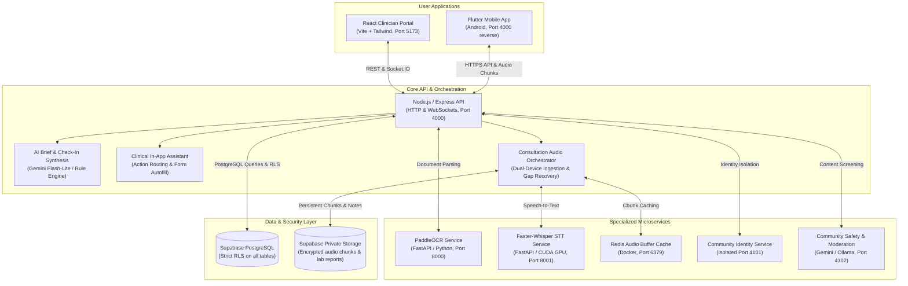

# Health-On (MedBrief) — Maternal Health & Clinical Decision Support Platform

[](https://reactjs.org/)
[](https://vitejs.dev/)
[](https://nodejs.org/)
[](https://expressjs.com/)
[](https://flutter.dev/)
[](https://fastapi.tiangolo.com/)
[](https://supabase.com/)
[](https://github.com/PaddlePaddle/PaddleOCR)
[](https://github.com/SYSTRAN/faster-whisper)

Welcome to **Health-On** (internally designated **MedBrief**), a comprehensive maternal healthcare platform and clinical decision-support ecosystem. Built specifically for prenatal and postpartum care, Health-On bridges the gap between expectant mothers and clinical care teams through continuous surveillance, intelligent pre-visit triage, ambient consultation recording, automated lab digitization, and zero-knowledge peer support.

---

## 📚 Root Documentation Suite

For quick navigation directly from GitHub, explore the core technical documents located in the repository root:

| Document | Purpose |
|---|---|
| **[SETUP.md](./SETUP.md)** | **Complete Installation & Setup Guide**: Step-by-step setup for Windows (PowerShell/CMD) and Linux (Ubuntu/Debian), environment configuration, database migrations, and troubleshooting. |
| **[ARCHITECTURE.md](./ARCHITECTURE.md)** | **System Architecture & Technical Specification**: Component topology, data flow sequence diagrams, database schemas, and cryptographic security models. |
| **[FEATURES.md](./FEATURES.md)** | **Core Features Deep Dive**: In-depth clinical and technical breakdowns of all 8 major platform capabilities. |
| **[AGENTS.md](./AGENTS.md)** | **Standing Rules & Safety Directives**: Clinical compliance, zero-PHI logging rules, and development protocols. |

---

## Architecture & System Overview

Health-On operates as a coordinated monorepo of specialized microservices, a web clinician dashboard, a mobile patient companion app, and a secure PostgreSQL datastore with Row-Level Security (RLS).



---

## Core Modules & Capabilities

### 1. AI-Powered Prenatal Surveillance & Check-In Cadence
Continuous prenatal monitoring between scheduled hospital visits designed to minimize survey fatigue while flagging acute complications (such as preeclampsia, intrauterine growth restriction, or depression):
- **Tier 1 — Routine Weekly Milestone Review (Every 7 Days)**: A 4-step progressive wizard dynamically tailored to gestational age (Trimester 1 morning sickness & hyperemesis, Trimester 2 quickening & fetal movement, Trimester 3/Term labor vs Braxton Hicks, mental health screening via EPDS/GAD-2, vitamin adherence).
- **Tier 2 — 30-Second Quick Pulse (Every 2–4 Days)**: 1-to-5 visual comfort scale with one-tap symptom chips (`Nausea`, `Pelvic pressure`, `Swelling`, `Headache`, `Fatigue`, `Heartburn`).
- **Tier 3 — 24/7 Ad-Hoc Concern Logger**: Always accessible for unscheduled issues, pain, spotting, or reduced fetal kicks.
- **Emergency Intercept Shield**: Immediate detection of red-flag symptoms (severe unilateral headache, visual scotoma, epigastric pain, bleeding) with instant emergency guidance and clinic hotline triggers.

### 2. Pre-Visit 30-Second AI Clinical Brief
Clinicians spend less than 30 seconds before entering the consultation room understanding the patient's longitudinal trajectory:
- **Interval-Scoped Synthesis**: Summarizes strictly what occurred *between* the previous appointment and the upcoming visit.
- **Triage Priority Badging**: Automatically classifies status as **Red** (urgent attention needed), **Amber** (review required), or **Green** (reassuring progression).
- **Trajectory Trend Analysis**: Highlights whether symptoms (e.g. swelling or nausea) are worsening, stable, or resolving.
- **Deterministic Offline Fallback**: If LLM provider limits or network disconnects occur, an offline clinical rule matching engine synthesizes the brief deterministically with 100% operational uptime.

### 3. Ambient Dual-Device Consultation Audio & Clinical Notes Drafter
Ambient recording inside the examination room without altering doctor-patient interaction:
- **Dual-Device Synchronized Recording**: Both doctor (web browser) and patient (mobile app) can record simultaneously to overcome directional noise and distance.
- **Streaming Audio Chunks**: 15–25 second chunks uploaded idempotently with cryptographic hashing and pause detection (`SILENCE_DBFS = -45 dB`).
- **Resilient Gap Recovery**: Automatic reconciliation for dropped network packets or delayed chunks.
- **STT Provider Agnostic**: Seamlessly switches between local CUDA-accelerated **Faster-Whisper** (`port 8001`) and **Sarvam AI** cloud speech models.
- **Automated SOAP Notes Draft**: Automatically drafts structured clinical consultation notes (Subjective, Objective, Assessment, Plan) with immediate clinician review, editing, and approval.

### 4. Automated Lab Report Digitization (OCR)
- **FastAPI + PaddleOCR Microservice**: Extracts machine-printed and scanned physical paper reports (CBC, iron panels, glucose tolerance, urine protein).
- **Metric Normalization Dictionary**: Normalizes hospital-specific variations (e.g. `"HGB"`, `"Hb"`, `"Hgb"` $\rightarrow$ `"hemoglobin"`) into standardized units and reference ranges.
- **Safety Triage**: Unmatched or low-confidence metrics are flagged for human clinician verification before landing in the longitudinal patient timeline.

### 5. Longitudinal Vitals & Clinical Alerting
- Real-time charting for Systolic/Diastolic Blood Pressure, Maternal Pulse, Fundal Height, Fetal Heart Rate (FHR), and Maternal Weight.
- Visual clinical threshold alerts (e.g., blood pressure $\ge$ 140/90 mmHg for preeclampsia surveillance; abnormal fetal heart rate ranges).
- Integration with Android Health Connect for connected home BP cuffs and scales.

### 6. Clinical In-App Assistant
- Embedded agentic AI assistant capable of multi-round reasoning, reading active screen contents, navigating patient records, and safely autofilling appointment details and checklists.
- Operates under strict clinician confirmation: the assistant prepares the data, but the clinician clicks the final button.

### 7. Post-Visit Action Checklists & Medication Decision Support
- Digital consultation notes, prescribed medications, and follow-up lab orders instantly translate into an interactive checklist on the patient's mobile device.
- Cross-references gestational safety categories, known maternal allergies, and contraindications before prescriptions are finalized.

### 8. Anonymous Peer-Support Community Subsystem
- **Zero-Knowledge 3-Tier Identity Isolation**: Complete architectural decoupling between Supabase Auth IDs, internal community pseudonyms, and public handles. Doctors and moderators cannot deanonymize users without a formal multi-party reveal audit.
- **Automated AI Safety & Moderation**: Dual moderation pipeline using Google Gemini or local Ollama to sanitize PII (phone numbers, addresses, personal names) and screen for distress before publication.
- **Background Notification Sweeper**: Push notification worker delivering empathetic check-in reminders and community replies.

---

## Monorepo Directory Map

```text
health-on-project/
├── client/                     # Clinician web dashboard (React 18, Vite, Tailwind CSS)
│   ├── src/components/         # Reusable UI, consult audio review, clinical brief cards
│   ├── src/pages/              # Clinician, patient portal, and appointment routes
│   └── .env.example            # Web client environment template
├── server/                     # Core backend API (Node.js, Express, Socket.IO)
│   ├── src/controllers/        # Express request controllers (checkin, audio, OCR, auth)
│   ├── src/services/           # Synthesis engines, AI drafters, envelope encryption
│   ├── src/community/          # Zero-knowledge community identity & safety services
│   ├── src/config/             # Centralized runtime configuration & threshold limits
│   ├── scripts/                # Database verification, key generation, migration utilities
│   └── .env.example            # Master backend environment template
├── mobile/                     # Patient companion mobile app (Flutter / Android)
│   ├── lib/                    # MVC architecture, check-in wizards, audio recorder
│   ├── android/                # Native Android manifests, permissions, audio services
│   ├── test/                   # Flutter unit & widget tests
│   └── config.example.json     # Mobile configuration template
├── PaddleOCRFastAPI/           # Document OCR microservice (FastAPI + PaddleOCR)
│   ├── main.py                 # FastAPI server exposing /ocr/predict endpoints
│   ├── Dockerfile              # Multi-stage container definition
│   └── requirements.txt        # Python dependency manifest
├── whisper-service/            # Local Speech-to-Text microservice (Faster-Whisper)
│   ├── main.py                 # Streaming & batch audio transcription endpoints
│   ├── run.sh                  # Local execution script with CUDA LD_LIBRARY_PATH
│   └── requirements.txt        # Python dependencies (fastapi, faster-whisper, av)
├── supabase/                   # Supabase database configuration
│   ├── migrations/             # Timestamped SQL migrations with RLS policies
│   ├── seed/                   # Synthetic development seed data
│   └── config.toml             # Supabase CLI configuration
├── docs/                       # Specifications, walk-throughs & architecture audits
│   ├── consult-audio/          # Audio pipeline implementation plans & walk-throughs
│   ├── prenatal-checkin/       # In-depth clinical brief and check-in documentation
│   └── SETUP.md                # Dedicated full setup guide for Windows & Linux
├── tools/                      # Diagnostic CLI tools (whisper tests, audio simulation)
├── setup.sh                    # Linux / macOS automated environment setup script
├── setup.bat                   # Windows CMD automated setup script
├── setup.ps1                   # Windows PowerShell automated setup script
├── start-all.sh                # Linux / macOS all-in-one multi-service launcher
├── start-all.bat               # Windows all-in-one multi-service launcher
├── SETUP.md                    # Comprehensive Windows & Linux setup instructions
└── README.md                   # Monorepo overview and documentation root
```

---

## Safety, Privacy & Clinical Compliance Principles

> [!IMPORTANT]
> Every developer and agent contributing to this repository must strictly adhere to these core safety mandates:

1. **Flags and Prioritises — Never Diagnoses**:
   - The platform strictly generates triage flags, longitudinal trajectories, and discussion topics. No AI output, UI label, or notification may state a clinical diagnosis.
2. **Zero Protected Health Information (PHI) in Telemetry**:
   - No patient names, audio files, transcript texts, or health measurements may appear in application console logs, error payloads, or analytics. Telemetry is restricted to anonymized IDs, counts, timestamps, and HTTP status codes.
3. **Synthetic Test Data Only**:
   - All automated test suites, fixtures, seed files, and mock payloads strictly use synthetic placeholder data. Real patient records are never used in test environments.
4. **Row-Level Security (RLS) & Envelope Encryption**:
   - Every single database table enforces PostgreSQL Row-Level Security. Uploaded medical reports and audio chunks are protected with envelope encryption (AES-256-GCM with RSA-4096 key wrapping).
5. **Deterministic Offline Resilience**:
   - When AI providers or network uplinks are degraded, critical clinical operations (such as pre-visit brief generation) smoothly fall back to deterministic clinical rule matching without service interruption.

---

## Quick Start & Setup

For full, step-by-step instructions for **Windows** and **Linux** machines, refer to the dedicated setup guide:

👉 **[Read the Full Windows & Linux Setup Guide (SETUP.md)](./SETUP.md)**

### Automated One-Command Setup

**On Linux / macOS:**
```bash
./setup.sh
```

**On Windows (PowerShell):**
```powershell
Set-ExecutionPolicy -Scope Process -ExecutionPolicy Bypass
.\setup.ps1
```

**On Windows (Command Prompt):**
```cmd
setup.bat
```

### Starting All Services

**On Linux / macOS:**
```bash
./start-all.sh
# Options: ./start-all.sh --core-only | --with-ocr | --with-redis | --status | --stop
```

**On Windows:**
```cmd
start-all.bat
```
*(Or `.\start-all.ps1` in PowerShell)*

---

## Automated Verification & Testing

Verify that your local environment is functioning correctly by running the automated test suites:

### Backend Test Suite (Node.js & Express)
```bash
cd server
npm test
```
*Runs 26 test suites (430+ unit and integration tests) covering check-in synthesis, consultation audio state machines, RLS validation, and role guards.*

### Frontend Test Suite (React & Vitest)
```bash
cd client
npm test
```
*Runs React component tests covering clinical brief cards, priority tiers, and consultation audio modals.*

### Mobile Test Suite (Flutter)
```bash
cd mobile
flutter test
```
*Tests multi-tier check-in wizard flows, comfort score pickers, and interval calculations.*

---

## Documentation Links

- **[SETUP.md](./SETUP.md)** — Exhaustive Windows & Linux setup instructions.
- **[ARCHITECTURE.md](./ARCHITECTURE.md)** — System architecture, topology, database models, and security.
- **[FEATURES.md](./FEATURES.md)** — Comprehensive deep dive into the 8 core clinical features.
- **[AGENTS.md](./AGENTS.md)** — Standing agent guidelines and clinical safety principles.
- **[docs/prenatal-checkin/PRENATAL_CHECKIN_AND_AI_BRIEF.md](./docs/prenatal-checkin/PRENATAL_CHECKIN_AND_AI_BRIEF.md)** — Prenatal check-in architecture and clinical brief schema.
- **[docs/consult-audio/IMPLEMENTATION.md](./docs/consult-audio/IMPLEMENTATION.md)** — Dual-device consultation audio pipeline technical specifications.
- **[docs/consult-audio/LOCAL_TESTING_GUIDE.md](./docs/consult-audio/LOCAL_TESTING_GUIDE.md)** — Audio pipeline local testing runbook.
- **[mobile/README.md](./mobile/README.md)** — Flutter mobile companion application guide.
- **[docs/deploy-railway.md](./docs/deploy-railway.md)** — Cloud deployment instructions on Railway / Render.

---

## License

This project is licensed under the Apache License 2.0 or individual software licenses specified within component subdirectories.
