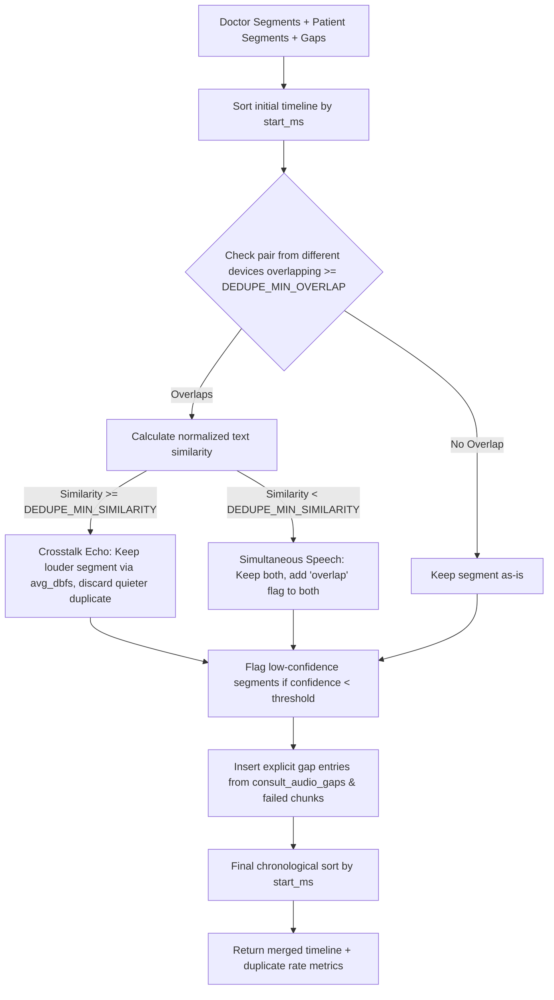

# Phase 7: Merge and Crosstalk Handling Implementation Plan

**Status:** Proposed — awaiting developer approval before editing code.  
**Specification:** `docs/consult-audio/IMPLEMENTATION.md` (Phase 7)  
**Ground Rules:** `AGENTS.md` (one phase at a time, planning mode first, privacy & safety rules strictly enforced).

---

## 1. Goal & Requirements

Build the **Merge and Crosstalk Handling** module to produce one clean, unified consultation timeline from two independently recording devices (doctor web recorder and patient Android recorder):

1. **Pure Function `mergeSegments(doctorSegments, patientSegments, options)`**:
   - Pure, deterministic function with zero I/O or database dependencies.
   - Sorts all utterances and timeline events chronologically by session time.
2. **Crosstalk Deduplication**:
   - If two segments from different devices overlap in time by at least `DEDUPE_MIN_OVERLAP` (default 50% of the shorter segment) **and** their text similarity is at least `DEDUPE_MIN_SIMILARITY` (default 80%), treat them as the same utterance captured by both microphones.
   - Retain only the **louder** segment based on chunk/segment `avg_dbfs`. Never hard-gate a speaker to zero.
3. **Simultaneous Speech Overlap Handling**:
   - If two segments overlap in time by $\ge$ `DEDUPE_MIN_OVERLAP` but their text similarity is $<$ `DEDUPE_MIN_SIMILARITY` (genuine different sentences spoken simultaneously), keep **both** segments and add the `'overlap'` flag to each.
4. **Normalized Text Comparison**:
   - Supports both **Devanagari** (Hindi, Marathi) and **Latin** (English).
   - Normalizes Unicode (NFKC), converts to lowercase, strips punctuation and extraneous whitespace.
   - Computes text similarity using token-level Dice and character bigram similarity.
5. **Low-Confidence & Gap Tagging**:
   - Flags low-confidence segments (`confidence < LOW_CONFIDENCE_THRESHOLD`, default 0.65) with `'low_confidence'`.
   - Embeds timeline gaps from `consult_audio_gaps` and failed audio chunks as explicit timeline items so they appear as visible gap entries, not silent holes.
6. **API Integration**:
   - Update `GET /api/consults/:id/transcript` to return the deduplicated, merged timeline with segment IDs, speakers, timestamps, and flags.
7. **Duplicate Rate Reporting**:
   - Calculate and report duplicate rate statistics on test fixtures for developer review.

---

## 2. Algorithm Design & Flow

---

## 3. Configuration & Tunables

In `server/src/config/consultAudio.config.js`:
- `dedupeMinOverlap: Number(env.DEDUPE_MIN_OVERLAP || 0.5)` (already exists)
- `dedupeMinSimilarity: Number(env.DEDUPE_MIN_SIMILARITY || 0.8)` (already exists)
- `lowConfidenceThreshold: Number(env.LOW_CONFIDENCE_THRESHOLD || 0.65)` (new)

In `server/.env.example`:
- Add `LOW_CONFIDENCE_THRESHOLD=0.65`.

---

## 4. Files to Create and Modify

### New Files
1. **`server/src/services/consultAudio/mergeSegments.js`**:
   - `normalizeText(text)`: Unicode NFKC normalization, lowercase, punctuation removal.
   - `calculateTextSimilarity(textA, textB)`: Token and character bigram similarity metric supporting Devanagari and Latin.
   - `calculateOverlapRatio(segA, segB)`: Computes temporal overlap share relative to the shorter segment.
   - `mergeSegments(doctorSegments, patientSegments, options)`: Pure merger implementing deduplication, overlap tagging, low-confidence flags, gap insertion, and chronological ordering. Returns merged segments with duplicate metrics.
2. **`tools/simulate-device/fixtures/merge-cases.json`**:
   - Synthetic cross-platform test fixtures covering quiet duplicate removal, overlapping different speech, Devanagari utterances, low confidence, and gaps.
3. **`server/src/tests/consultAudio/mergeSegments.test.js`**:
   - Unit tests covering pure merger logic, math, Devanagari/Latin comparisons, and stats calculation.
4. **`docs/consult-audio/PHASE_7_IMPLEMENTATION_PLAN.md`**:
   - Approved implementation plan.

### Existing Files to Update
1. **`server/src/config/consultAudio.config.js`**:
   - Add `lowConfidenceThreshold`.
2. **`server/.env.example`**:
   - Document `LOW_CONFIDENCE_THRESHOLD`.
3. **`server/src/services/consultAudio/session.service.js`**:
   - Update `getSessionTranscript`: query doctor segments, patient segments, chunk loudness (`avg_dbfs`), and `consult_audio_gaps`, call `mergeSegments`, and return the unified merged timeline.
4. **`server/src/tests/consultAudio/consultAudioApi.test.js`**:
   - Add integration tests for `GET /api/consults/:id/transcript` asserting merged timeline and gap responses.
5. **`docs/consult-audio/FILES_AND_PURPOSE.md`**:
   - Document Phase 7 files.

---

## 5. Verification & Acceptance Criteria

| Acceptance Criterion | Verification Method |
|---|---|
| **1. Quiet Duplicate Removal** | Synthetic case where doctor and patient pick up the same phrase (overlap > 0.5, similarity > 0.8). Quieter device segment is dropped; louder device segment is kept. |
| **2. Simultaneous Speech (Overlap)** | Two different sentences spoken at the same time (overlap > 0.5, similarity < 0.8). Both segments are kept and tagged with flag `'overlap'`. |
| **3. Explicit Gap Entries** | Gaps in `consult_audio_gaps` and failed audio chunks appear in the timeline as explicit gap objects with `flags: ['gap', reason]`, never silent holes. |
| **4. Multilingual Normalization** | Text similarity correctly equates Devanagari phrases and Latin phrases despite minor punctuation or whitespace differences. |
| **5. Configurable Thresholds** | All thresholds (`dedupeMinOverlap`, `dedupeMinSimilarity`, `lowConfidenceThreshold`) derive from config, not hardcoded bodies. |
| **6. Duplicate Rate Metric** | Report duplicate rate on test fixtures as a documented metric for developer review. |
| **7. Privacy & Safety Check** | Zero transcript text or clinical values in logs or socket events. |

---

## 6. Definition of Done Checklist

- [ ] Pure function `mergeSegments` implemented with clean mathematical boundaries.
- [ ] Multilingual normalization tested on Devanagari and Latin.
- [ ] `GET /api/consults/:id/transcript` returns merged segments with gap entries.
- [ ] Synthetic fixtures created in `tools/simulate-device/fixtures/merge-cases.json`.
- [ ] All new unit tests pass in `mergeSegments.test.js`.
- [ ] Full existing test suite passes (`npm test`).
- [ ] Walkthrough document written with duplicate rate metrics, test evidence, and known gaps.
