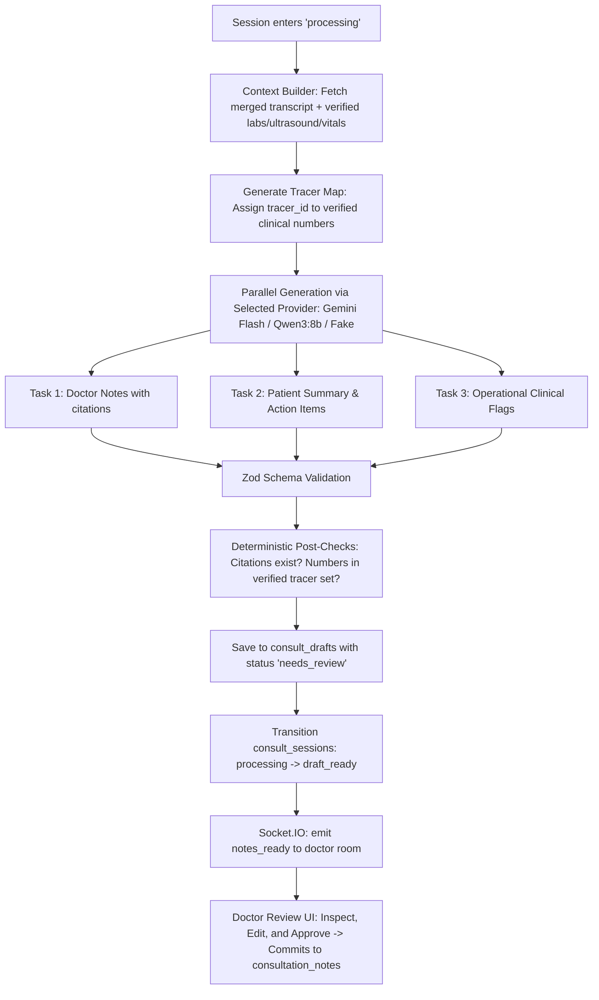

# Phase 8: Notes Drafting (Interface and Checks) Implementation Plan

**Status:** Proposed — awaiting developer approval before editing code.  
**Specification:** `docs/consult-audio/IMPLEMENTATION.md` (Phase 8)  
**Standing Rules:** `AGENTS.md` (one phase at a time, planning mode first, privacy & safety rules strictly enforced, no diagnostic statements, zero transcript text in logs).

---

## 1. Goal & Requirements

Transform the deduplicated, merged consultation timeline (from Phase 7) into a **reviewable clinical draft** within the time budget, guaranteeing strict tracer verification, deterministic citation checks, and human-in-the-loop review:

1. **Dual / Pluggable Model Providers**:
   - Primary: **Google Gemini Flash** (`gemini-1.5-flash` or `gemini-2.0-flash`) with schema-enforced structured JSON output.
   - Local testing: **Qwen3:8b** (`qwen3:8b` or `qwen2.5:8b`) via local HTTP endpoint (e.g. Ollama `/api/chat` or OpenAI-compatible `/v1/chat/completions`) with JSON mode.
   - Test fixture: **FakeDraftProvider** for deterministic, zero-network unit and CI tests.
   - Config-driven swapping via `DRAFT_MODEL_PROVIDER` (`'gemini'` | `'local'` | `'fake'`), exactly matching how STT swaps between Sarvam, local Whisper, and fake.
2. **Context Builder & Verified Tracer Verification**:
   - Ingests:
     - Merged transcript with `segment_id`s from Phase 7.
     - Structured pre-visit intake and questionnaires (`questionnaire_responses`).
     - Verified lab results from `lab_report_metrics` (`needs_review = false` or `reviewed_by is not null`) and `pregnancy_investigations` (`dismissed_at is null`).
     - Verified ultrasound findings from `pregnancy_ultrasounds`.
     - Recorded vitals from `vitals_logs` and `antenatal_visits`.
   - **Tracer Verification Rule**: Every verified numeric clinical value is tagged with a deterministic tracer ID. The model is permitted to quote verified numbers only if linked to their tracer ID. If a number is mentioned verbally in the room but not found in verified structured data, it must be labeled `"stated verbally, unverified"`. Any unverified lab or ultrasound metric referenced must read `"[value pending verification]"`.
3. **Parallel Schema-Enforced Generation**:
   - Executes 3 concurrent model tasks via `Promise.all`:
     1. **Doctor Notes Draft**: Chief complaint, vitals observed, assessment (strictly descriptive, never a medical diagnosis), and plan & recommendations citing `cited_segment_ids`.
     2. **Patient Summary**: Accessible language summary, action checklist, and red-flag warning signs.
     3. **Clinical Flags**: Operational risk flags with severity (`low`, `medium`, `high`) and supporting `cited_segment_ids`.
   - Enforced by repo's validation library (**Zod**).
4. **Deterministic Post-Check Engine**:
   - Every cited `segment_id` must exist in the input merged transcript.
   - Every numeric claim is matched against the verified tracer set or verified disclaimers (`"stated verbally, unverified"` / `"[value pending verification]"`).
   - Any hallucinated segment ID or unverified numeric claim flags the draft for human review with explicit `review_reasons`.
   - Under no circumstances does the system auto-publish.
5. **Storage, State Machine & Notifications**:
   - New table `consult_drafts` with `status = 'needs_review'`.
   - Moves session state: `processing` $\rightarrow$ `draft_ready`.
   - Emits push notification `notes_ready` via Socket.IO to connected doctor and patient clients.
   - Late chunk safety: If a late chunk arrives after drafting, Phase 6's `draft_outdated: true` flag signals that a re-draft is required.
6. **Clinician Review & Approval Endpoint**:
   - `GET /api/consults/:id/draft`: Returns reviewable draft, citations, tracers, and validation flags.
   - `POST /api/consults/:id/draft/review`: Doctor approves (committing notes into `consultation_notes` and updating `consult_drafts.status = 'approved'`), edits, or rejects the draft.

---

## 2. Architecture & Data Flow



---

## 3. Database Schema Migration

File: `supabase/migrations/20261102000002_consult_drafts.sql`

```sql
create table if not exists consult_drafts (
  id uuid primary key default gen_random_uuid(),
  session_id uuid not null references consult_sessions(id) on delete cascade,
  appointment_id uuid not null references appointments(id) on delete cascade,
  status text not null default 'needs_review' check (status in ('needs_review', 'approved', 'rejected')),
  provider text not null check (provider in ('gemini', 'local', 'fake')),
  model_version text not null,
  doctor_notes jsonb not null,
  patient_summary jsonb not null,
  clinical_flags jsonb not null,
  tracers_used jsonb not null default '[]'::jsonb,
  review_reasons text[] not null default '{}',
  latency_ms integer,
  created_at timestamptz not null default now(),
  updated_at timestamptz not null default now()
);

create index if not exists idx_consult_drafts_session on consult_drafts(session_id, created_at desc);
create index if not exists idx_consult_drafts_appointment on consult_drafts(appointment_id);

alter table consult_drafts enable row level security;

-- Policies matching consult_sessions participant access
create policy "Doctors can view consult drafts" on consult_drafts
  for select using (
    exists (
      select 1 from consult_sessions cs
      where cs.id = consult_drafts.session_id and cs.doctor_id = auth.uid()
    )
  );

create policy "Patients can view consult drafts" on consult_drafts
  for select using (
    exists (
      select 1 from consult_sessions cs
      where cs.id = consult_drafts.session_id and cs.patient_id = auth.uid()
    )
  );

create policy "Doctors can update consult drafts" on consult_drafts
  for update using (
    exists (
      select 1 from consult_sessions cs
      where cs.id = consult_drafts.session_id and cs.doctor_id = auth.uid()
    )
  );
```

---

## 4. Provider Abstraction & Directory Layout

Create new directory: `server/src/services/consultAudio/drafting/`

1. **`draftProvider.interface.js`**:
   - Standard interface: `generateDoctorNotes()`, `generatePatientSummary()`, `generateClinicalFlags()`.
2. **`geminiDraftProvider.js`**:
   - Calls Google Generative Language REST API (`/v1beta/models/{model}:generateContent?key={apiKey}`).
   - Sets `responseMimeType: "application/json"` and `responseSchema`.
   - Default model: `gemini-1.5-flash` (configurable).
3. **`localDraftProvider.js`**:
   - Calls local LLM HTTP endpoint (e.g. Ollama `/api/chat` or `/v1/chat/completions`).
   - Default model: `qwen3:8b` (configurable via `LOCAL_LLM_MODEL`).
   - Sets `format: 'json'`.
4. **`fakeDraftProvider.js`**:
   - Returns deterministic, schema-compliant outputs using real `segment_id`s from the input transcript and verified tracer values.
   - Allows tests to simulate citation failures or unverified number hallucinations for acceptance testing.
5. **`draftProviderFactory.js`**:
   - Resolves provider by name from `consultAudio.config.js`.

---

## 5. Tracer Verification & Context Builder

File: `server/src/services/consultAudio/drafting/tracerVerification.js`

- **`buildStructuredContext(appointmentId, patientId)`**:
  - Queries `lab_report_metrics` where `needs_review = false` or `reviewed_by is not null`.
  - Queries `pregnancy_investigations` where `dismissed_at is null`.
  - Queries `pregnancy_ultrasounds`.
  - Queries `vitals_logs` and `antenatal_visits`.
  - Queries `questionnaire_responses`.
- **`buildTracerCatalog(structuredData)`**:
  - Assigns unique tracer tokens: e.g. `{ tracer_id: 'TRACER_HEMOGLOBIN_10.8', metric: 'hemoglobin', value: 10.8, unit: 'g/dL', source: 'lab_report' }`.
- **`postCheckDraft({ draft, validSegmentIds, tracerCatalog })`**:
  - Validates that every citation in `cited_segment_ids` exists in `validSegmentIds`.
  - Performs regex extraction of numeric clinical values in text:
    - If a clinical numeric quantity is found without a corresponding verified tracer ID or without the `"stated verbally, unverified"` disclaimer, adds `review_reasons: ['unverified_numeric_claim']`.
    - If a made-up `segment_id` is found, adds `review_reasons: ['invalid_segment_citation']`.
  - Returns `{ isValidForApproval: boolean, reviewReasons: string[] }`.

---

## 6. Endpoints to Add / Update

In `server/src/routes/consultAudio.routes.js` and `server/src/controllers/consultAudio.controller.js`:

1. **`GET /api/consults/:id/draft`**:
   - Requires session token or doctor/patient user auth.
   - Returns latest draft from `consult_drafts`, including `doctor_notes`, `patient_summary`, `clinical_flags`, `tracers_used`, `status`, `review_reasons`.
2. **`POST /api/consults/:id/draft/review`**:
   - Requires doctor auth.
   - Body: `{ action: 'approve' | 'reject', editedDoctorNotes?, rejectionReason? }`.
   - On `'approve'`: Updates `consult_drafts.status = 'approved'`, upserts final text into `consultation_notes` (bridging seamlessly with the clinician dashboard).
3. **`POST /api/consults/:id/draft/generate`**:
   - Re-runs drafting on-demand (e.g. after late chunks arrive or if clinician requests re-draft).

---

## 7. Configuration & Environment Variables

In `server/src/config/consultAudio.config.js`:
- `draftModelProvider`: `env.DRAFT_MODEL_PROVIDER || 'gemini'` (`'gemini'` | `'local'` | `'fake'`)
- `geminiDraftModel`: `env.GEMINI_DRAFT_MODEL || 'gemini-1.5-flash'`
- `geminiApiKey`: `env.GEMINI_API_KEY || ''`
- `localLlmUrl`: `env.LOCAL_LLM_URL || 'http://localhost:11434/api/chat'`
- `localLlmModel`: `env.LOCAL_LLM_MODEL || 'qwen3:8b'`
- `draftTimeoutMs`: `Number(env.DRAFT_TIMEOUT_MS || 25000)`

In `server/.env.example`:
- Add `DRAFT_MODEL_PROVIDER=gemini`
- Add `GEMINI_DRAFT_MODEL=gemini-1.5-flash`
- Add `LOCAL_LLM_URL=http://localhost:11434/api/chat`
- Add `LOCAL_LLM_MODEL=qwen3:8b`
- Add `DRAFT_TIMEOUT_MS=25000`

---

## 8. Verification & Acceptance Criteria

| Acceptance Criterion | Verification Method |
|---|---|
| **1. Pluggable Providers** | Provider factory switches between `gemini`, `local` (qwen3:8b), and `fake` with zero code modifications. |
| **2. Schema Compliance** | Zod schemas strictly validate output for Doctor Notes, Patient Summary, and Clinical Flags. |
| **3. Invalid Citation Rejection** | Output with made-up `segment_id` is caught by deterministic post-check and marked with `review_reasons: ['invalid_segment_citation']`. |
| **4. Unverified Number Flagging** | An unverified clinical number spoken in audio or hallucinated by model is labeled `"stated verbally, unverified"` or sent to review. |
| **5. Status & Push Event** | Session moves from `processing` $\rightarrow$ `draft_ready`, draft saved with status `needs_review`, Socket.IO emits `notes_ready`. |
| **6. Turnaround Time Benchmark** | Synthetic 5,000-word benchmark test measures End-to-NotesReady turnaround time and asserts completion within time budget. |
| **7. Clinician Approval Bridge** | Doctor approving draft updates status to `'approved'` and persists text into `consultation_notes`. |
| **8. Strict Privacy & Safety** | Zero transcript text or clinical numbers in application logs or socket payloads. No diagnosis text in UI or output. |

---

## 9. Definition of Done Checklist

- [ ] Supabase migration `20261102000002_consult_drafts.sql` with RLS.
- [ ] Provider interface with `GeminiDraftProvider`, `LocalDraftProvider`, and `FakeDraftProvider`.
- [ ] Context builder querying `pregnancy_investigations`, `lab_report_metrics`, `vitals_logs`, `pregnancy_ultrasounds`.
- [ ] Tracer catalog generator and deterministic post-check engine.
- [ ] Parallel execution of 3 prompt calls with Zod schema validation.
- [ ] Session transitions to `draft_ready` and emits `notes_ready`.
- [ ] `GET /api/consults/:id/draft` and `POST /api/consults/:id/draft/review` endpoints.
- [ ] Unit tests for tracer checks, citation validation, schemas, and provider factory.
- [ ] Integration tests verifying end-to-end drafting, late-chunk dirtying, and clinician approval.
- [ ] All existing and new tests pass (`npm test`).
- [ ] Walkthrough document written with timing measurements, test evidence, and known gaps.
