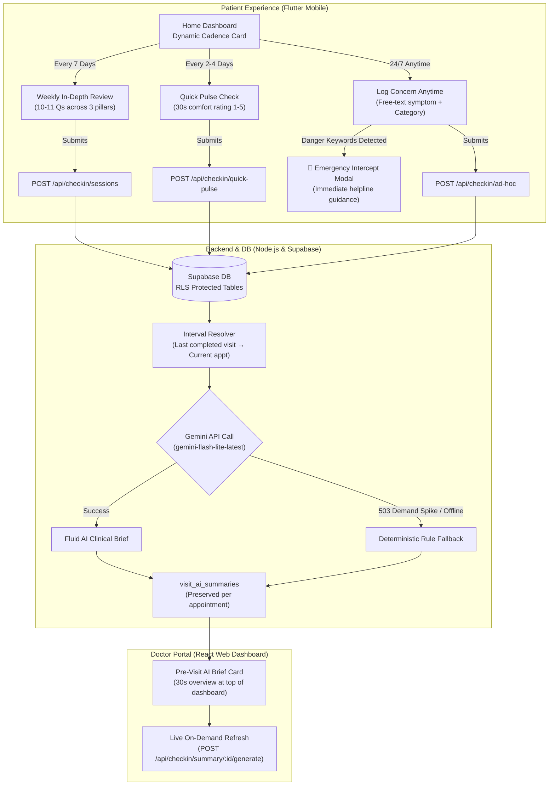

# Prenatal Check-In & AI Pre-Visit Clinical Brief

Comprehensive architecture, clinical research, database schemas, API contracts, and user interactions for the AI-powered prenatal check-in and clinical brief system in MedBrief.

---

## 1. Executive Summary & Clinical Background

### The Clinical Problem
In standard prenatal care, pregnant patients visit their obstetrician every 4 weeks in early pregnancy, every 2 weeks starting at week 28, and weekly after week 36. 

During the multi-week intervals between visits:
1. **Recall Bias & Symptom Normalization:** Patients often forget when mild symptoms began or normalize acute complications (e.g., attributing preeclamptic visual scotoma, persistent headaches, or sudden edema to "normal pregnancy fatigue").
2. **Under-reported Perinatal Mental Health:** Perinatal mood and anxiety disorders (PMAD) affect ~20% of pregnant individuals. Due to perceived stigma and rushed 12-minute appointments, fewer than 1 in 5 discuss feelings of panic, intrusive worry, or depression in person.
3. **Doctor Cognitive Overload:** Doctors do not have the time to read raw, unstructured chat transcripts or multi-page questionnaire histories. They need a **30-second distilled clinical brief** highlighting red flags and trajectories before entering the exam room.

### The Solution: 3-Tier Monitoring + Interval AI Synthesis
An end-to-end, privacy-compliant, and strictly non-breaking system:
- **Tier 1 — Weekly Milestone Review (Every 7 Days):** Comprehensive 10–11 question check-in tailored to gestational age (Physical sensations, EPDS/GAD-2 mental health screening, medication adherence, and questions for the doctor).
- **Tier 2 — Regular 30-Second Quick Pulse (Every 2–4 Days):** Low-friction heartbeat check (comfort scale 1–5, quick symptoms chip, and optional short note) keeping data current without patient survey fatigue.
- **Tier 3 — 24/7 Ad-Hoc Concern Logger (Always Available):** Spontaneous reporting anytime a symptom or question occurs (e.g., *"Today I felt stomach aches regularly after lunch"*), with an automated emergency intercept for danger signs.
- **Backend Interval Scoping (Node.js & Supabase):** Automatically bounds data collection from the patient's **last completed physical visit** up to the upcoming appointment. Past visits retain an immutable snapshot of their historical briefs.
- **AI Pre-Visit Brief (Google Gemini `gemini-flash-lite-latest`):** Synthesizes interval data into a structured 30-second summary (Priority Tier, Obstetric Alerts, 3-Pillar Trajectories, Patient Agenda, and Suggested Clinical Focus) with an automated deterministic clinical rule fallback.

---

## 2. End-to-End User & Patient Flow

### Detailed Flow Walkthrough:

#### A. Patient Mobile Dashboard States
1. **Weekly Due (`routine_weekly`):** Prompted every 7 days. Card displays: *"Weekly Check-In Due • Comprehensive milestone review for doctor (2 mins)"* with a **"Start (2m)"** button opening the 4-step wizard.
2. **Quick Pulse Due (`quick_pulse`):** Prompted every 2–4 days between weekly reviews. Card displays: *"Quick Pulse Due • How are you and baby feeling today? (30 secs)"* with a **"Quick Check"** button opening the comfort scale sheet.
3. **All Caught Up:** When check-ins are up to date, the card shows a green checkmark: *"You're all caught up! • Check-in recorded today • Next pulse in X days"*.
4. **24/7 Ad-Hoc Concern Logger:** Dedicated card right below: *"Have a concern right now? Log a symptom or note for your doctor anytime"* with **"Log Concern"**.

#### B. Emergency Safety Intercept
* If a patient enters danger signs (e.g., vaginal bleeding, fluid leakage, severe headache with blurred vision, sudden facial edema, or decreased fetal kicks) or selects "Severe", the form immediately activates a high-priority red alert banner advising immediate emergency triage with direct clinic contacts.

#### C. Separation from Original Appointment Check-In
* **Original Appointment Check-In:** Located on the **Appointments Tab** under each visit card. This handles clinic-assigned questionnaire templates and pre-visit checklists (`/api/questionnaire`). It remains 100% independent.
* **New Periodic Prenatal Check-In:** Located on the **Home Dashboard Tab**. Manages ongoing interval symptom monitoring, mood screening, and AI summarization (`/api/checkin`).

#### D. Doctor Web Portal Review
* When a clinician opens an upcoming appointment, the **Pre-Visit AI Brief Card** renders at the top of their dashboard:
  * **Priority Tier Badge:** `Urgent Priority` (red), `Priority Watch` (amber), or `Routine Baseline` (green).
  * **Interval Scoping Badge:** E.g., `Interval: 9 days since last visit (2026-10-25)`.
  * **Priority Obstetric Alerts:** Red-flag summary.
  * **3-Pillar Trajectories:**
    * *Physical Sensations:* Connects weekly reviews, pulses, and spontaneous concerns (e.g., *"Patient noted back pain during routine weekly check-in and submitted an ad-hoc concern on 2026-11-03..."*).
    * *Emotional Well-Being:* EPDS/GAD-2 mood, anxiety, and sleep synthesis.
    * *Daily Routine & Meds:* Vitamin and supplement adherence.
  * **Patient's Agenda for Today:** Surfaced patient questions (e.g., *""Is it okay to have a lot of peanuts?""*).
  * **Suggested Clinical Focus:** Concrete doctor talking points and evaluation suggestions.
  * **Refresh Button:** On-demand re-synthesis button that regenerates the brief if new patient entries arrive.
  * **Past Visit History:** Past completed appointments permanently preserve their historical summary snapshots.

---

## 3. Non-Negotiable Safety & Privacy Rules

1. **Flags and Prioritises; Never Diagnoses:** The feature surfaces alerts, priority tiers, and clinical trends. Neither UI copy nor LLM outputs ever issue a definitive medical diagnosis.
2. **Strict Privacy in Logs:** No patient names, audio, raw chat transcripts, or sensitive health numbers are recorded in server logs, analytics, or error outputs. Only IDs, counts, timings, and status codes.
3. **Deterministic Clinical Fallback:** If Google's API experience temporary demand spikes (HTTP 503), timeouts, or offline conditions, the backend automatically switches to a deterministic clinical rule engine so doctors always receive their brief.
4. **Row-Level Security (RLS):** Every database table is protected by Postgres RLS scoped to authenticated patient and clinician roles.

---

## 4. Architecture & File Catalog

### A. Database Migrations (`supaBase/`)
- **`supaBase/migrations/20261103000000_pregnancy_checkin_ai.sql`:**
  - `patient_checkin_sessions`: Session tracking with RLS.
  - `patient_checkin_answers`: Answer records with categories (`physical`, `mental`, `medical`, `concern`).
  - `visit_ai_summaries`: Pre-visit clinical briefs keyed by appointment ID.
- **`supaBase/migrations/20261103100000_pregnancy_checkin_cadence.sql`:**
  - Updates `session_type` constraint to include `quick_pulse` and `ad_hoc_concern`.
  - Adds interval tracking columns: `interval_start`, `interval_end`, `interval_description`.
- **`supaBase/rollbacks/`:** Safe rollback scripts.

### B. Server Implementation (`server/`)
- **`server/src/config/checkin.config.js`:** Centralized cadence settings (quick pulse interval: 3 days, weekly interval: 7 days, model: `gemini-flash-lite-latest`, emergency keywords).
- **`server/src/validators/checkin.validators.js`:** Zod validation schemas for sessions, quick pulses, and ad-hoc concerns.
- **`server/src/services/checkin.service.js`:** Session recording, status calculation (`getCheckinStatus`), and red-flag escalation.
- **`server/src/services/checkinAi.service.js`:** Interval scoping from last completed appointment, Gemini 2.5/Flash-Lite prompt generation, and deterministic rule fallback.
- **`server/src/controllers/checkin.controller.js`:** Controller endpoints for sessions, ad-hoc logs, quick pulses, status, and brief synthesis.
- **`server/src/routes/checkin.routes.js`:** Mounted at `/api/checkin` in `server/src/app.js`.
- **`server/src/tests/checkin.test.js`:** Automated test suite (14 passed tests).

### C. Patient Mobile App (`mobile/`)
- **`mobile/lib/features/checkin/checkin_models.dart`:** Data models (`CheckinAnswerPayload`, `CheckinSessionResult`, `CheckinCadenceStatus`, `VisitAiSummary`).
- **`mobile/lib/features/checkin/prenatal_questions.dart`:** Gestational-week filtered question bank.
- **`mobile/lib/features/checkin/guided_checkin_page.dart`:** 4-step progressive card UI with emergency modal.
- **`mobile/lib/features/checkin/quick_pulse_sheet.dart`:** 30-second comfort scale (1–5) and quick symptoms sheet.
- **`mobile/lib/features/checkin/ad_hoc_concern_sheet.dart`:** 24/7 spontaneous concern logger with emergency keyword scanning.
- **`mobile/lib/features/checkin/checkin_repository.dart`:** API client methods for all checkin operations.
- **`mobile/lib/features/home/home_tab.dart`:** Dynamic cadence card & 24/7 concern card.
- **`mobile/lib/features/home/home_controller.dart`:** Parallel loader for appointments, vitals, and check-in cadence status.
- **`mobile/test/checkin_flow_test.dart`:** Automated Flutter widget & flow tests (7 passed tests).

### D. Clinician Web Portal (`client/`)
- **`client/src/components/clinician/PreVisitAiBriefCard.jsx`:** 30-second collapsible pre-visit brief card rendering priority status, interval badge, red flags, 3-pillar trajectories, patient agenda, and doctor talking points.
- **`client/src/services/clinicianService.js`:** Brief retrieval and on-demand synthesis trigger.
- **`client/src/pages/clinician/ClinicianDashboard.jsx`:** Embedded brief card with live patch updates.
- **`client/src/tests/preVisitAiBrief.test.jsx`:** Vitest component tests (8 passed tests).

---

## 5. API Endpoints

| Method | Endpoint | Role | Description |
| :--- | :--- | :--- | :--- |
| `POST` | `/api/checkin/sessions` | Patient | Submit comprehensive weekly or pre-visit check-in |
| `POST` | `/api/checkin/quick-pulse` | Patient | Submit 30-second comfort pulse check (every 2–4 days) |
| `POST` | `/api/checkin/ad-hoc` | Patient | 24/7 Spontaneous patient symptom or concern log (with emergency intercept) |
| `GET` | `/api/checkin/status` | Patient / Clinician | Retrieve check-in cadence status and upcoming due type |
| `GET` | `/api/checkin/history` | Authenticated | Retrieve historical check-in sessions (supports `?lookbackDays=X`) |
| `GET` | `/api/checkin/summary/:appointmentId` | Clinician / Patient | Retrieve the synthesized AI pre-visit clinical brief |
| `POST` | `/api/checkin/summary/:appointmentId/generate` | Clinician | Generate or re-synthesize interval brief (last visit → this appointment) |

---

## 6. Verification & Automated Test Evidence

- **Backend Test Suite (`server/src/tests/checkin.test.js`):** **14/14 passed** (covering input validation, red-flag escalation, 24/7 ad-hoc logging, quick pulses, status cadence calculation, and interval scoping).
- **Mobile Flutter Test Suite (`mobile/test/checkin_flow_test.dart`):** **7/7 passed** (covering trimester filtering, emergency intercepts, guided wizard, ad-hoc concern sheet, quick pulse sheet, and home cadence card).
- **Web Client Test Suite (`client/src/tests/preVisitAiBrief.test.jsx`):** **8/8 passed** (covering priority alerts, 3-pillar trajectories, interval description display, and safety disclaimers).
